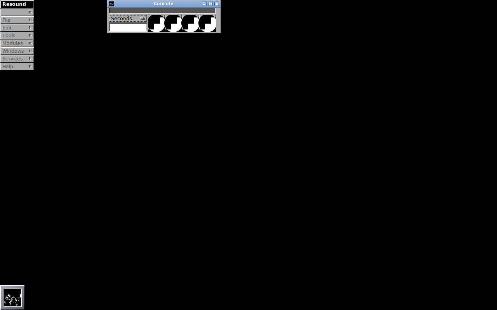

# Resound

Resound 3.0 is Sean Luke’s sound editor for Rhapsody, preserved by the [New GNUstep Application Project (nu-gap)](https://nu-gap.github.io/) as a starting point for future GNUstep work.

<p align="center">
  
</p>

_Resound running under GNUstep (whole screen, so every window the app shows up is in it).  Auto-captured by CI into the [`screenshot`](https://github.com/nu-gap/apps-resound/tree/screenshot) branch — it fills in as the port adds UI ([how](docs/README_SCREENSHOT.md))._

See also: [https://nu-gap.github.io/apps-resound/README.html](https://nu-gap.github.io/apps-resound/README.html)

**Status:** GNUstep port in progress — every push builds in CI against a source-built GNUstep + SndKit stack and is runtime-verified there (SndKit smoke tests, file I/O contract tests, NIB conversion checks, and an app launch under a virtual display; the screenshot above is captured from that run). Milestones:

- [x] SndKit integration — the 1998 SoundKit replaced by SndKit (sound object, file I/O)
- [x] Audio engine — playback and recording
- [x] View chain and console — sound view, volume meter, sound tracker
- [x] NIB migration — the 1998 `.nib` folders converted to `.gorm` (43/44, one documented exception), gated in CI
- [x] File unit — the 1998 main model live at app startup (main window + menu; the `FileController` and its document table ported in FU1–FU3, FU4 stubs the model's still-blocked classes)
- [ ] Volume controls and tapper — the next unit
- [ ] Module API and the ten module implementations
- [ ] Packaging and validation on the target platforms

The 1998 Rhapsody application and module binaries in the archive are historical reference; the port builds from the 1998 sources.

## Features

The original distribution provides:

- Sound editing, playback, and recording through Rhapsody’s SoundKit.
- Reading of AIFF, AU, SND, IFF, VOC, WAV, and various MPEG formats; writing is limited to SND.
- A module system with Channel, EchoChamber, Envelope, FFT, Filter, Gate, Math, Mix, WaveBuilder, and Zero modules.
- Module API documentation and source code.

See the [original distribution notes](README.html) for historical behavior, installation instructions, and known recording and playback issues.

## Get the source

```sh
git clone https://github.com/nu-gap/apps-resound.git
cd apps-resound
```

## Repository layout

| Path | Contents |
| --- | --- |
| `Source/` | Objective-C application source, Project Builder files, interfaces, and build scripts |
| `Source/Modules/` | Source for the bundled sound-processing modules |
| `Resound.app/` | Historical Rhapsody application bundle |
| `ResoundModules/` | Historical compiled modules |
| `API/` | Module API documentation |
| `original-archive/` | Preserved original distribution archive |
| `README.html` | Original distribution documentation |
| `NU-GAP-IMPORT.md` | Import provenance, pinned upstream commit, and compatibility notes |

## Building

The original build requires a Rhapsody development environment, including SoundKit, AppKit, and Project Builder’s makefiles. The repository does not currently provide a GNUstep build configuration.

For reference, the historical build instructions are:

```sh
cd Source
./Build
```

`Build` compiles the application and its modules for the current architecture. `BuildFat` builds for both historical PowerPC and Intel targets. These commands describe the original toolchain; they have not been tested as part of the nu-gap import.

Read [Source/README.COMPILING](Source/README.COMPILING) for the complete original build and packaging instructions. Read [README.html](README.html) for installation on Rhapsody, including where to place the application and modules.

## GNUstep porting

Work toward a GNUstep version will need to address the legacy SoundKit audio interfaces, Project Builder build system, and archived interface files. Useful contributions include documenting dependencies, preparing a reproducible build, adapting audio handling, and validating editing and module behavior.

Please describe your operating system, toolchain, and steps to reproduce when [reporting an issue](https://github.com/nu-gap/apps-resound/issues). Preserve original copyright and license notices when contributing.

## History and credits

Resound was written by Sean Luke, with contributions and incorporated code credited in the original source and documentation, including MiscKit components and Jerome Genest’s file readers.

This repository was imported from [IOOI-SqAR/Resound](https://github.com/IOOI-SqAR/Resound) on November 1, 2026, preserving all three upstream commits and the `Resound-3.0-P-bs` tag. See [NU-GAP-IMPORT.md](NU-GAP-IMPORT.md) for the exact source revision. The [upstream documentation site](https://iooi-sqar.github.io/Resound/README.html) remains available as a historical reference.

## Licensing

The distribution contains components with different license terms. Original notices are retained in the source files and [original distribution notes](README.html); no single repository-wide license is asserted here.

In particular, the original documentation states that Jerome Genest’s `FileType.subproj` readers may be reused and redistributed only for non-profit purposes unless permission is granted. Review the applicable component notices before reuse or redistribution. The original distribution is provided without guarantees of support.
