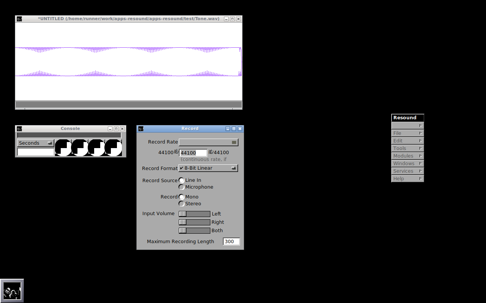

# Resound

Resound 3.0 is Sean Luke’s sound editor for Rhapsody, preserved by the [New GNUstep Application Project (nu-gap)](https://nu-gap.github.io/) as a starting point for future GNUstep work. On the [`gnustep-port`](https://github.com/nu-gap/apps-resound/tree/gnustep-port) branch it is in the middle of a real port: the defunct 1998 `SoundKit` audio framework is replaced by [SndKit](https://github.com/leighsmith/MusicKit), the Project Builder build system by a gnustep-make compatible `GNUmakefile`, and the legacy `.nib` interfaces by converted `.gorm` archives — with the 1998 sources kept byte-identical except for the documented mappings (see `docs/RESOUND_SNDKIT_PLAN.md`).

<p align="center">
  
</p>

_Resound running under GNUstep (whole screen, so every window the app shows up is in it).  Auto-captured by CI into the [`screenshot`](https://github.com/nu-gap/apps-resound/tree/screenshot) branch — it fills in as the port adds UI ([how](docs/README_SCREENSHOT.md))._

See also: [https://nu-gap.github.io/apps-resound/README.html](https://nu-gap.github.io/apps-resound/README.html)

**Status:** GNUstep port in progress — every push builds in CI against a source-built GNUstep + SndKit stack and is runtime-verified there (SndKit smoke tests, file I/O contract tests, NIB conversion checks, and an app launch under a virtual display; the screenshot above is captured from that run). Milestones:

- [x] SndKit integration — the 1998 SoundKit replaced by SndKit (sound object, file I/O)
- [x] Audio engine — playback and recording
- [x] View chain and console — sound view, volume meter, sound tracker
- [x] NIB migration — the 1998 `.nib` folders converted to `.gorm` (43 of 44, one documented exception), gated in CI
- [x] File unit — the 1998 main model live at app startup (main window + menu)
- [x] Inspector and controller chain — 25 of the 26 1998 application classes in the build; the main model instantiates the real inspector and controller objects
- [x] Preferences — the 1998 preferences panel, live from the Edit menu and runtime-verified end to end
- [ ] Module API and the ten module implementations
- [ ] Packaging and validation on the target platforms

The bundled Rhapsody-era module bundles (`ResoundModules/`) and the preserved original archive are historical reference; the port builds from the 1998 sources.

## Features

The original distribution provides:

- Sound editing, playback, and recording through the Rhapsody `SoundKit` (replaced by SndKit in this port).
- Reading of AIFF, AU, SND, IFF, VOC, WAV, and various MPEG formats; writing was limited to SND (in the port, writing extends to the formats SndKit writes, with a sample-format guard for 8-bit data).
- A module system with Channel, EchoChamber, Envelope, FFT, Filter, Gate, Math, Mix, WaveBuilder, and Zero modules.
- Module API documentation and source code.

See the [original distribution notes](README.html) for historical behavior, installation instructions, and known recording and playback issues.

## Get the source

```sh
git clone https://github.com/nu-gap/apps-resound.git
cd apps-resound
git checkout gnustep-port        # the GNUstep port branch
```

## Repository layout

| Path | Contents |
| --- | --- |
| `GNUmakefile` (+ `.preamble` / `.postamble`) | the port’s build rules (gnustep-make `application.make`), plus `ResoundInfo.plist` |
| `Source/` | Objective-C application source — the Rhapsody-era code, ported unit by unit |
| `Source/Modules/` | source for the bundled sound-processing modules (1998; own build targets, not ported yet) |
| `Resources/` | app resources: the converted `.gorm` folders (the 1998 `.nib` twins stay side by side), tiffs, documentation |
| `Resound.app/` | in-tree build bundle (generated, git-ignored) — run `./Resound.app/Resound` from the tree |
| `test/` | the three CI gate tools: `sndsmoke` (SndKit file I/O), `resoundio` (the file-I/O contract suite), `resoundnib` (the `.gorm` assets) + the `Tone.wav` input |
| `third_party/` | vendored dependencies: the `MusicKit` git submodule (SndKit source, pinned) and `build-sndkit.sh` |
| `patches/` | port patches for the pinned dependencies (see `docs/UPSTREAM_PATCHES.md`) |
| `docs/` | project documentation: the build system, the SndKit plan, the upstream patches, the CI screenshot, and the [architecture decision records](docs/adrs/README.md) |
| `API/` | module API documentation |
| `ResoundModules/` | historical compiled module bundles (Rhapsody era; the converted `.gorm` twins of their `.nib`s ride along in them) |
| `original-archive/` | preserved original distribution archive |
| `README.html` | original distribution documentation |
| `NU-GAP-IMPORT.md` | import provenance, pinned upstream commit, and compatibility notes |

## Building

The port builds with a GNUstep development environment (gnustep-make) and the SndKit audio framework:

```sh
# once: the SndKit chain (frameworks + flat libraries + headers, into the active prefix)
git submodule update --init
third_party/build-sndkit.sh

# then, in the repository root
make -f GNUmakefile            # builds Resound.app/ in the tree
./Resound.app/Resound         # run it (needs a display)
make -C test                   # the three gate tools
```

The system package prerequisites are `portaudio19-dev` and `libsndfile1-dev` (plus `libportmidi-dev` for the unused MIDI half of SndKit’s backend). See [`docs/GNUSTEP_BUILD.md`](docs/GNUSTEP_BUILD.md) for the full setup — including the source-built GNUstep stack the CI runs, the port patches, the test gates, and the file-by-file source classification — and [`docs/RESOUND_SNDKIT_PLAN.md`](docs/RESOUND_SNDKIT_PLAN.md) for the audio-migration plan and its status.

The historical Rhapsody build, for reference (it requires Rhapsody with SoundKit and Project Builder):

```sh
cd Source
./Build
```

`Build` compiles the application and its modules for the current architecture; `BuildFat` builds for both historical PowerPC and Intel targets. These commands describe the original toolchain and have not been exercised as part of the nu-gap import. Read [Source/README.COMPILING](Source/README.COMPILING) for the complete original build and packaging instructions, and [README.html](README.html) for installation on Rhapsody.

## The GNUstep port

The port proceeds unit by unit against the 1998 sources, each unit small, build-verified against the CI stack, and committed on its own: the 1998 files stay byte-identical except for the documented SndKit mappings, and every behaviour change is called out where it happens. The architecture decisions behind the port are recorded as ADRs in [`docs/adrs/`](docs/adrs/README.md). What remains: the module system (the ten module implementations and the DSP architecture decision), the one non-app helper (`MiscTapper`), and packaging plus validation on the target platforms (GNUstep/Linux, Mac OS X Server 1.2, modern macOS).

Please describe your operating system, toolchain, and steps to reproduce when [reporting an issue](https://github.com/nu-gap/apps-resound/issues). Preserve the original copyright and license notices when contributing.

## History and credits

Resound was written by Sean Luke, with contributions and incorporated code credited in the original source and documentation, including MiscKit components and Jerome Genest’s file readers.

This repository was imported from [IOOI-SqAR/Resound](https://github.com/IOOI-SqAR/Resound) on November 1, 2026, preserving all three upstream commits and the `Resound-3.0-P-bs` tag. See [NU-GAP-IMPORT.md](NU-GAP-IMPORT.md) for the exact source revision. The original distribution notes remain in the tree ([`README.html`](README.html)) and in the [upstream repository](https://github.com/IOOI-SqAR/Resound/blob/Resound-3.0-P-bs/README.html); the upstream documentation site is no longer online.

## Licensing

The original distribution contains components with different license terms. Original notices are retained in the source files and the [original distribution notes](README.html). In particular, the original documentation states that Jerome Genest’s `FileType.subproj` readers may be reused and redistributed only for non-profit purposes unless permission is granted (the port replaces them with SndKit/libsndfile’s native readers; the notices remain in the tree).

The root `LICENSE` carries the Apache License 2.0, added with the nu-gap import; it covers the project’s own content — the port code, the build system, the documentation, and the tests — while the 1998 components keep their respective file-level notices. Consult the applicable notices before reuse or redistribution; the original distribution is provided without guarantees of support.
